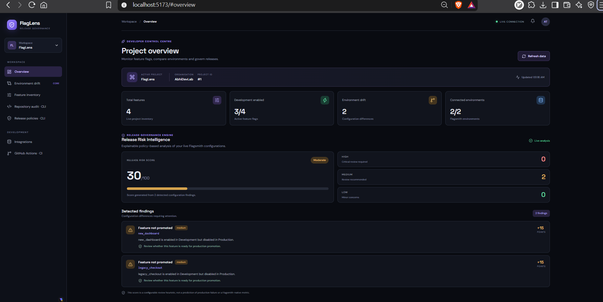
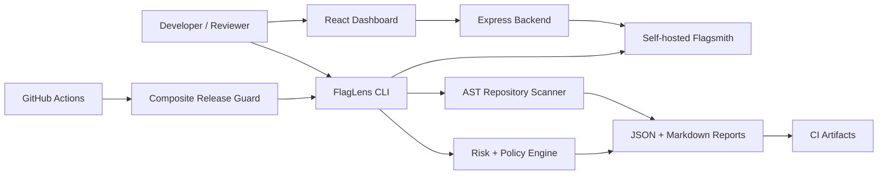
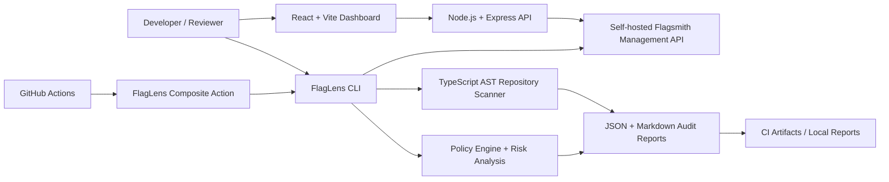

<!-- FlagLens project README -->

<div align="center">

# 🔎 FlagLens

### Release Governance for Self-Hosted Flagsmith

**Inspect. Analyze. Enforce. Audit.**

A release-governance toolkit that helps teams detect feature-flag drift, scan application code, evaluate release policies, and prevent risky releases through GitHub Actions.

[](https://github.com/AbhiDevLab/FlagLens/actions/workflows/quality.yml)
[](LICENSE)
[](https://nodejs.org/)
[](https://react.dev/)
[](https://www.typescriptlang.org/)

[🎬 Watch the FlagLens demo on Loom](https://www.loom.com/share/434de16b05b7431c8052a709ed3d2e54) · [📦 GitHub Repository](https://github.com/AbhiDevLab/FlagLens) · [🏗️ Architecture](docs/architecture.md)

</div>

---

## 🎯 The Problem

Feature flags make it easier to release features gradually, but configuration drift between Development and Production, unknown feature references in source code, and unsafe flag states can introduce release risk.

**FlagLens adds a governance layer around self-hosted Flagsmith.** It checks configuration and source code before release, evaluates configurable rules, and produces an auditable decision.

## ✨ What FlagLens Does

| Capability | What it helps you do |
|---|---|
| 📊 **Live dashboard** | View projects, environments, feature flags, configuration drift and risk findings |
| 🔍 **AST repository scanner** | Find unknown feature references, unresolved dynamic references and configured flags not found in scanned source |
| ⚖️ **Release policy engine** | Evaluate configurable rules for risky Production states and missing environment states |
| 🧾 **Audit reports** | Generate JSON and Markdown reports with findings, decisions and remediation guidance |
| 🚦 **GitHub Actions guard** | Pass clean checks or block a release that violates configured rules, while retaining audit artifacts |

## 🎬 Project Demonstration

Watch the recorded FlagLens walkthrough:

**[▶ Watch the FlagLens demonstration on Loom](https://www.loom.com/share/434de16b05b7431c8052a709ed3d2e54)**

> The demonstration is shared through Loom. Reviewers can watch it using the link without signing in.

## 🖥️ Dashboard Preview

The screenshot below is a captured view of the FlagLens dashboard connected to a self-hosted Flagsmith project. Live values will depend on the connected Flagsmith instance.



## 🧭 How It Works

1. **Connect** FlagLens to a self-hosted Flagsmith project.
2. **Compare** Development and Production feature states.
3. **Scan** supported JavaScript and TypeScript source files for feature-flag references.
4. **Evaluate** findings against the configured release policy.
5. **Generate** JSON and Markdown audit reports.
6. **Enforce** the decision in GitHub Actions: approve passing checks or block a release that violates policy.

> **Important:** FlagLens is a governance and review tool. It does not automatically promote, toggle or delete Production feature flags.

## 🧪 Release Guard: Two Demonstration Scenarios

| Scenario | Expected result | Why |
|---|---|---|
| ✅ Clean application | **Pass** | No blocking unknown feature references are found under the configured checks |
| ⛔ Negative application | **Blocked** | The fixture contains an unknown feature reference, so strict release enforcement rejects it |

A blocked negative run may appear as **Failed** in GitHub Actions. That is the expected result when the guard correctly rejects the release. The audit report should still be uploaded for review.

## 🧰 Technology Stack

- **Frontend:** React, TypeScript, Vite
- **Backend:** Node.js, Express
- **Repository analysis:** TypeScript Compiler API (AST)
- **Feature management:** Self-hosted Flagsmith Management API
- **Automation:** GitHub Actions and a reusable composite action
- **Reports and policy:** JSON, Markdown and configurable JSON policy

## 🖼️ Architecture at a Glance

See [the full architecture and data-flow documentation](docs/architecture.md).



---

## 📚 Documentation & Setup

- [Prerequisites](#prerequisites)
- [1. Configure Flagsmith](#1-configure-flagsmith)
- [2. Install and configure FlagLens](#2-install-and-configure-flaglens)
- [3. Run the dashboard](#3-run-the-dashboard)
- [4. Use the CLI](#4-use-the-cli)
- [5. Configure release policies](#5-configure-release-policies)
- [6. Add the GitHub Actions release guard](#6-add-the-github-actions-release-guard)
- [Scanner support and limitations](#scanner-support-and-limitations)
- [Understanding risk scores and decisions](#understanding-risk-scores-and-decisions)
- [Troubleshooting](#troubleshooting)
- [Security guidance](#security-guidance)
- [Development and tests](#development-and-tests)
- [Project layout](#project-layout)
- [License](#license)

## Why FlagLens?

Feature flags make controlled releases easier, but a flag can be configured differently between environments, referenced in code without a matching Flagsmith definition, or exposed in Production before it has been reviewed.

FlagLens adds a governance layer around a self-hosted Flagsmith project:

1. **Inspect** Development and Production configuration.
2. **Compare** global feature states and highlight drift.
3. **Scan** application source for statically identifiable feature references.
4. **Evaluate** configurable release rules.
5. **Decide** whether configured checks pass or block the release.
6. **Keep evidence** in JSON and Markdown reports, including for blocked runs.

FlagLens is an independent review and CI tool. It does not replace Flagsmith, automatically promote flags, or change Production configuration.

## What it does

| Capability | What you get |
|---|---|
| Web dashboard | Organisation/project overview, environment connections, feature inventory, drift indicators and risk findings |
| CLI | Project, environment and feature inspection; audits; repository scanning; policy checks; report generation |
| Repository intelligence | TypeScript compiler API-based parsing of supported JavaScript/TypeScript files, source locations, unresolved dynamic references and unreferenced configured flags |
| Release policies | Configurable rules for Production-only flags, experimental flags, missing states and medium-severity findings |
| GitHub Actions | Composite action and manual Release Guard workflow with strict enforcement and downloadable audit artifacts |

## Architecture

The application architecture and data flow are documented in [docs/architecture.md](docs/architecture.md). The diagram below shows the main components.



**Data flow:** the dashboard calls the local FlagLens API; the API and CLI read project, environment and feature data from Flagsmith. The CLI additionally scans the selected source directory and evaluates the local policy file. In CI, the composite action runs the CLI and uploads generated reports.

## Prerequisites

- A running **self-hosted Flagsmith** instance with a project containing environments named exactly `Development` and `Production`.
- An organisation-level Flagsmith Management API token with read access to the project and its environments.
- The client-side environment keys for the Development and Production environments.
- Node.js **24 or later** and npm.
- Git.
- Docker Engine and Docker Compose if you are setting up Flagsmith locally.
- For the included Release Guard workflow: a Windows x64 self-hosted GitHub Actions runner that can reach the Flagsmith URL.

> **Important:** FlagLens currently expects environment names `Development` and `Production`. If your Flagsmith project uses different names, rename those environments or adapt the mapping in the application before use.

## 1. Configure Flagsmith

If you do not already have a self-hosted instance, follow the official [Flagsmith self-hosting guide](https://docs.flagsmith.com/deployment-self-hosting/hosting-guides/docker).

1. Start your self-hosted Flagsmith instance.
2. Create or select an organisation and project.
3. Ensure the project has environments named `Development` and `Production`.
4. Create a few feature flags and configure their states in both environments.
5. Create an organisation Management API token with the read permissions required by the endpoints used by FlagLens.
6. Copy the client-side environment key for each environment.

Keep the organisation token private. Do not put it in frontend code or commit it to Git.

## 2. Install and configure FlagLens

Clone the repository:

```bash
git clone https://github.com/AbhiDevLab/FlagLens.git
cd FlagLens
```

Create the backend environment file.

**Windows PowerShell:**
```powershell
Copy-Item backend/.env.example backend/.env
```

**Windows Command Prompt:**
```cmd
copy backend\.env.example backend\.env
```

**macOS / Linux:**
```bash
cp backend/.env.example backend/.env
```

Edit `backend/.env`:

```dotenv
PORT=4000
FLAGSMITH_BASE_URL=http://localhost:8000
FLAGSMITH_API_KEY=your-organisation-management-api-token
FLAGSMITH_DEVELOPMENT_ENV_KEY=your-development-environment-key
FLAGSMITH_PRODUCTION_ENV_KEY=your-production-environment-key
```

Use the base URL of your own Flagsmith instance. If Flagsmith is hosted on another machine or container network, replace `localhost` with a hostname reachable from the FlagLens backend and CLI.

Install each component's locked dependencies in separate terminals:

```bash
cd backend
npm ci
```

```bash
cd frontend
npm ci
```

```bash
cd cli
npm ci
```

The backend and CLI both read the credentials from `backend/.env`. The frontend does not receive the organisation API token; it calls the local backend.

## 3. Run the dashboard

Start the backend:

```bash
cd backend
npm run dev
```

Start the frontend in a second terminal:

```bash
cd frontend
npm run dev
```

Open **http://localhost:5173**.

The backend API listens on **http://localhost:4000** by default. Its health endpoint is:

```text
http://localhost:4000/api/health
```

The dashboard loads project `1` by default. If your Flagsmith project has a different numeric ID, update the project ID used by the dashboard in `frontend/src/App.tsx` (`/api/flagsmith/overview/1`) to match your project.

The dashboard presents:
- Project and organisation information.
- Connected environment status.
- Feature counts and Development enabled counts.
- Differences between global Development and Production feature states.
- Risk findings and recommendations.
- Searchable feature inventory.

Use **Refresh data** to retrieve the latest configuration from Flagsmith.

## 4. Use the CLI

Run CLI commands from the `cli/` directory. The CLI reads:
- Flagsmith credentials from the repository's `backend/.env`.
- The policy from the repository-root `flaglens.policy.json` by default.

All commands support the global project option `--project <id>`. The default project ID is `1`.

### Inspect projects, environments and flags

```bash
npm start -- projects
npm start -- --project 1 environments
npm start -- --project 1 flags
```

### Run a release risk audit

```bash
npm start -- --project 1 audit
```

This compares the global feature states of Development and Production and prints risk findings and recommendations.

### Scan an application repository

```bash
npm start -- scan ../examples/clean-app
```

Output as JSON:

```bash
npm start -- scan ../examples/clean-app --format json
```

Make unknown feature references fail the command:

```bash
npm start -- scan ../examples/negative-app --strict
```

The scan command uses the Flagsmith feature definitions from the selected project to identify:
- Source references whose feature key is not defined in Flagsmith.
- Configured feature definitions not found in the scanned source.
- References whose keys cannot be resolved statically, for manual review.
- File paths, line numbers and detected SDK method names.

### Generate audit reports

Generate Markdown:

```bash
npm start -- report --format markdown --scan-path ../examples/clean-app
```

Generate JSON:

```bash
npm start -- report --format json --scan-path ../examples/clean-app
```

Generate both formats:

```bash
npm start -- report --format both --scan-path ../examples/clean-app
```

Choose an output directory and enable strict scanning:

```bash
npm start -- report --format both --scan-path ../examples/clean-app --strict --output-dir ./reports
```

| Option | Meaning |
|---|---|
| `--format json` | Generate `flaglens-report.json` |
| `--format markdown` | Generate `flaglens-report.md` |
| `--format both` | Generate both files |
| `--scan-path <directory>` | Include repository scan evidence |
| `--strict` | Block when unknown statically resolved feature references are found |
| `--output-dir <directory>` | Write reports to the selected directory |

The report contains project and environment context, risk analysis, scanner results, policy evaluation, release status and recommendations. When a release is blocked, the report files are written **before** the CLI returns exit code `1`, so CI can still upload the evidence.

Without `--scan-path`, the report marks repository scanning as not requested and the overall report as incomplete. A blocked report returns a non-zero exit code. A passing report means only that the configured checks passed; it is not a guarantee that a deployment is safe.

## 5. Configure release policies

The default policy is stored at the repository root in `flaglens.policy.json`:

```json
{
  "version": 1,
  "rules": {
    "blockProductionOnlyFlags": true,
    "blockExperimentalFlagsInProduction": true,
    "failOnMissingStates": true,
    "maxMediumFindings": 5
  }
}
```

To create a default policy in a fresh project, run:

```bash
npm start -- policy init
```

To evaluate the policy against the current Flagsmith project:

```bash
npm start -- policy check
```

Edit the JSON values to match your team's release process. Keep the file under version control so developers and CI evaluate the same rules. The policy engine validates the policy structure before evaluation.

## 6. Add the GitHub Actions release guard

FlagLens includes:
- `.github/workflows/quality.yml` — backend tests, CLI/scanner tests, frontend lint and frontend production build.
- `.github/workflows/flaglens-guard.yml` — manually triggered Release Guard workflow.
- `.github/actions/flaglens-guard/action.yml` — reusable composite action for this repository's workflow.

### Configure the runner and secrets

The included workflow is configured for a **Windows x64 self-hosted runner** with labels `self-hosted`, `windows` and `x64`. The runner must be able to reach the Flagsmith instance at the configured URL. The checked-in workflow currently uses `http://127.0.0.1:8000`, which assumes Flagsmith is running on the runner host and listening on port 8000.

In **Repository → Settings → Secrets and variables → Actions**, add:

| Secret | Value |
|---|---|
| `FLAGSMITH_API_KEY` | Organisation Management API token |
| `FLAGSMITH_DEVELOPMENT_ENV_KEY` | Development environment client-side key |
| `FLAGSMITH_PRODUCTION_ENV_KEY` | Production environment client-side key |

Do not put tokens directly in workflow YAML.

### Run the included demonstration

1. Open the repository's **Actions** tab.
2. Select **FlagLens Release Guard**.
3. Select **Run workflow**.
4. Choose `examples/clean-app` to demonstrate a clean approval.
5. Run it again with `examples/negative-app` to demonstrate strict blocking.
6. Open each run and download its `flaglens-audit-<run-id>` artifact.

The clean fixture is expected to pass. The negative fixture is expected to be blocked because it contains a feature reference that does not match the configured Flagsmith definitions. GitHub may display the negative run with a **failure** conclusion; that is the intended enforcement result, not a failed positive test. The artifact upload step is configured to run even when the guard blocks the release.

### Reuse the composite action

The composite action can be referenced by another workflow in the same repository:

```yaml
name: Application Release Governance

on:
  workflow_dispatch:

permissions:
  contents: read

jobs:
  guard:
    runs-on: [self-hosted, windows, x64]
    steps:
      - uses: actions/checkout@v7.0.1

      - uses: actions/setup-node@v7.1.0
        with:
          node-version: "24"

      - name: Run FlagLens
        uses: ./.github/actions/flaglens-guard
        with:
          project-id: "1"
          flagsmith-base-url: ${{ secrets.FLAGSMITH_BASE_URL }}
          flagsmith-api-key: ${{ secrets.FLAGSMITH_API_KEY }}
          development-environment-key: ${{ secrets.FLAGSMITH_DEVELOPMENT_ENV_KEY }}
          production-environment-key: ${{ secrets.FLAGSMITH_PRODUCTION_ENV_KEY }}
          scan-path: "."
          policy-path: "flaglens.policy.json"
          fail-on-unknown: "true"

      - name: Upload audit reports
        if: always()
        uses: actions/upload-artifact@v7.0.2
        with:
          name: flaglens-audit-${{ github.run_id }}
          path: |
            flaglens-report.json
            flaglens-report.md
          if-no-files-found: warn
```

For another repository, copy or vendor the `.github/actions/flaglens-guard` action and its required `cli/`, `backend/src/riskEngine.js`, and policy dependencies, or publish a versioned action from a dedicated repository. The current local action reference is not a marketplace-published action.

**Runner security:** do not run untrusted pull-request code on a privileged self-hosted runner. Restrict who can trigger the workflow and who can modify its secrets, runner and policy.

## Scanner support and limitations

The scanner uses the TypeScript compiler API to parse supported source files. Current extensions are:

`.js`, `.jsx`, `.ts`, `.tsx`, `.mjs`, `.cjs`.

It recognises supported Flagsmith calls including `hasFeature`, `getValue` and `isFeatureEnabled`, direct receiver patterns, supported aliased methods and statically resolvable string constants. It reports unresolved dynamic keys separately for manual review, and reports parse warnings for files it cannot parse.

The scanner currently excludes common generated/dependency directories including `node_modules`, `.git`, `dist`, `build`, `coverage`, `.next` and `.vite`.

It is **not** a complete whole-program data-flow or runtime analysis engine. It does not guarantee detection of every SDK integration, dynamic key, computed expression, indirect wrapper, framework-specific single-file component, or runtime-generated reference. Vue and Svelte files are not currently included. Review the scan results and manually inspect dynamic references before using them as a release decision.

An unreferenced configured flag is a review candidate, not proof that it is stale or safe to delete. FlagLens does not delete flags.

## Understanding risk scores and decisions

The risk engine applies deterministic heuristics to global feature states in Development and Production. Current findings include:

| Finding | Points |
|---|---:|
| Feature enabled in Development but disabled in Production | 15 |
| Feature enabled in Production but disabled in Development | 35 |
| Experimental/debug/internal-style feature enabled in Production | 25 |
| Missing global state in either environment | 10 |

The total score is capped at 100 and mapped to Low, Moderate, High or Critical bands by the risk engine. The score is a configurable review heuristic, **not** a statistical prediction of production incidents or a Flagsmith-native metric.

Policy evaluation is separate from the score: a policy can block a release when a configured rule is violated. A release is approved only when the report's required data is available and the configured checks pass. A passing check is not a substitute for code review, testing, staged rollout or operational monitoring.

FlagLens reads global feature states; it does not evaluate every identity, segment, trait, environment override or user-specific targeting path.

## Troubleshooting

| Symptom | Checks |
|---|---|
| Dashboard cannot connect | Confirm backend is running on port 4000, frontend on 5173, and `http://localhost:4000/api/health` responds |
| Flagsmith returns 401/403 | Verify the organisation Management API token and its read permissions |
| Flagsmith connection refused | Check `FLAGSMITH_BASE_URL`, instance status, port and network reachability from the backend/CLI process |
| Environment shows disconnected | Confirm exact environment names and the corresponding client-side keys in `backend/.env` |
| Project not found | Check the numeric project ID; the dashboard currently requests project ID 1 by default |
| CLI cannot find credentials | Run commands from `cli/` and verify the repository-root `backend/.env` exists and contains valid values |
| Policy check fails | Validate `flaglens.policy.json` and review each reported violation |
| CI cannot reach Flagsmith | Confirm the self-hosted runner can reach the configured URL; `127.0.0.1` refers to the runner machine itself |
| Negative CI run is red | This is expected when the guard correctly blocks the negative fixture; confirm the report artifact uploaded |

## Security guidance

- Keep the organisation Management API token on the backend/CLI/CI side. Never expose it in browser code.
- Do not commit `backend/.env`, tokens, environment keys or generated secrets.
- Use GitHub Actions Secrets for CI credentials.
- Limit the self-hosted runner to trusted workflows and maintainers.
- Use HTTPS and appropriate network controls when Flagsmith is not running on the same host.
- Treat reports as potentially sensitive because they contain project names, flag names, source paths and configuration findings.
- Review recommendations before changing Production.
- FlagLens does not automatically promote, toggle or delete Flagsmith features.

## Development and tests

Run the automated checks from each package directory.

**Backend tests:**
```bash
cd backend
npm ci
npm test
```

**CLI, scanner, policy and report tests:**
```bash
cd cli
npm ci
npm test
```

**Frontend lint and production build:**
```bash
cd frontend
npm ci
npm run lint
npm run build
```

The repository's Quality Checks workflow runs these same checks on pushes to its configured branches and on pull requests targeting `master`.

## Project layout

```text
FlagLens/
├── .github/
│   ├── actions/flaglens-guard/   # Reusable composite action
│   └── workflows/                # Quality checks and release guard
├── backend/
│   ├── src/                      # Express API and risk engine
│   └── test/                     # Backend tests
├── cli/
│   ├── src/                      # CLI, AST scanner, policy and reports
│   └── test/                     # CLI and integration tests
├── docs/
│   └── architecture.md           # Architecture and data-flow diagram
├── examples/
│   ├── clean-app/                # Expected approval fixture
│   ├── negative-app/             # Expected blocking fixture
│   └── sample-app/               # Scanner example
├── frontend/
│   └── src/                      # React dashboard
├── backend/.env.example
├── flaglens.policy.json
├── LICENSE
└── README.md
```

## License

FlagLens is licensed under the [MIT License](LICENSE).
