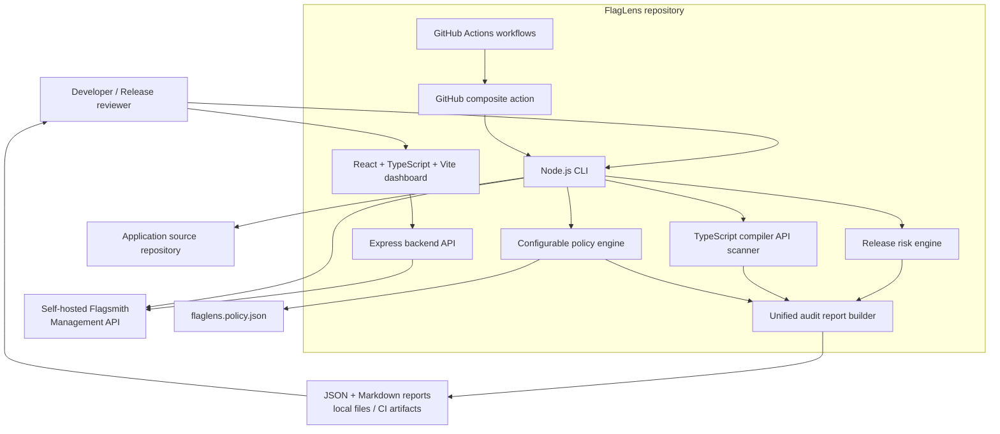

# FlagLens architecture

FlagLens is a release-governance layer for a self-hosted Flagsmith project. It separates the dashboard/API experience from the CLI-based repository scan and policy enforcement path.

## Component diagram

## Responsibilities

| Component | Responsibility |
|---|---|
| Dashboard | Displays project overview, environment connections, global feature-state drift, inventory and risk findings |
| Express backend | Keeps the Flagsmith Management API token server-side and exposes dashboard data endpoints |
| Flagsmith | Source of truth for project, feature definitions, environments and feature states |
| CLI | Retrieves Flagsmith context and runs audits, scans, policy checks and report generation |
| AST scanner | Parses supported JavaScript/TypeScript files and reports statically identifiable feature references |
| Risk engine | Calculates deterministic configuration-risk findings from Development and Production global states |
| Policy engine | Evaluates configured release rules and produces violations |
| Report builder | Combines project context, risk, scanner and policy evidence into JSON and Markdown |
| Composite action | Installs CLI dependencies, validates credentials/connectivity, runs report generation and preserves the exit code |
| GitHub Actions | Runs repository quality checks and the manually triggered release guard |

## Data and decision flow

1. A developer configures a self-hosted Flagsmith project with Development and Production environments.
2. The dashboard calls the FlagLens Express API. The backend reads Flagsmith data using the organisation Management API token.
3. The CLI reads the same Flagsmith project context and optionally scans a target source directory.
4. The risk engine evaluates global Development/Production state differences. The policy engine evaluates the configured rules from `flaglens.policy.json`.
5. The report builder writes JSON and/or Markdown audit evidence.
6. In strict mode, policy violations or unknown statically resolved feature references can cause the CLI to return a non-zero exit code.
7. The GitHub composite action preserves that exit code while the workflow's always-run artifact step uploads reports generated before enforcement.

## Trust boundaries and operational notes

- The organisation Management API token belongs in backend/CLI environment configuration or GitHub Actions Secrets. It must not be bundled into frontend assets.
- The included workflow targets a trusted Windows x64 self-hosted runner. Its configured Flagsmith URL must be reachable from that runner.
- The scanner is static analysis, not runtime execution or whole-program data-flow analysis. Dynamic references require human review.
- Risk scores are deterministic heuristics. A passing policy check is not a guarantee of deployment safety.
- FlagLens does not automatically mutate, promote or delete Flagsmith feature flags.
